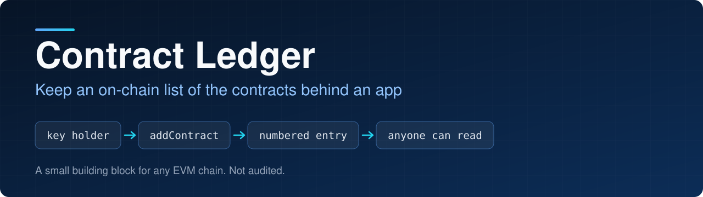
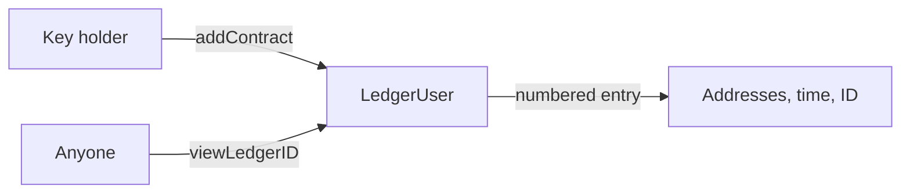

<p align="center">
  
</p>

<p align="center">
  
<a href="https://github.com/CoinClubQuincy/ContractLedger/actions/workflows/build.yml"></a>        
</p>

<p align="center">
  <a href="#how-it-works">How it works</a> · <a href="#try-it">Try it</a> · <a href="#what-is-tested">What is tested</a> · <a href="#known-issues">Known issues</a>
</p>

Contract Ledger lets a person or a contract keep an on-chain list of contract addresses. An app with many contracts can keep them in one place, and a front end can read that list instead of hard-coding the addresses. The same pattern also stores lists of token IDs or strings.

> [!WARNING]
> This is a proof of concept. It has not been audited and has not run on a real network. Everything in a ledger is public.

## How it works



| Contract | Use | Add function | Read function |
| --- | --- | --- | --- |
| `LedgerUser` | Ready to deploy. Holding a key token allows adding | `addContract(addresses)` | `viewLedgerID(id)` |
| `LedgerContract` | Inherit it for lists of addresses | Internal `addContract` | `viewLedgerID(id)` |
| `LedgerContractToken` | Inherit it for lists of token IDs | Internal `addTokenInt` | `viewIntLedgerID(id)` |
| `LedgerContractData` | Inherit it for lists of strings | Internal `addData` | `viewDataLedgerID(id)` |

Every read returns the list, the time it was added, its ID and whether it exists. Each add emits an event carrying the ID, because a wallet cannot read a function's return value.

The base contracts have no access control of their own. Whoever inherits them decides who may add.

## Try it

```bash
git clone https://github.com/CoinClubQuincy/ContractLedger.git
cd ContractLedger
git clone --depth 1 -b v4.9.6 https://github.com/OpenZeppelin/openzeppelin-contracts lib/openzeppelin-contracts
git clone --depth 1 -b v1.9.7 https://github.com/foundry-rs/forge-std lib/forge-std
forge test
```

You need [Foundry](https://getfoundry.sh).

## What is tested

[`test/foundry/Ledger.t.sol`](test/foundry/Ledger.t.sol) has 12 tests, including one fuzz test, and runs in CI on every push.

| Tested | Not tested |
| --- | --- |
| Adding and reading in all four contracts | A real network, testnet or mainnet |
| Key access, and access moving with the key | An independent security audit |
| Refusing empty entries and zero keys | |
| Entries that do not exist, and events | |
| Fuzz: IDs count up and entries stay separate | |

## Changes from earlier versions

Contracts already deployed are unaffected and keep the old behaviour.

- The three base ledgers are now `abstract`. They could be deployed before, but nothing could ever be added to them.
- Each add emits an event with its ID, and empty lists are refused.
- `LedgerUser` refuses zero keys, which would have left nobody able to add.
- The Hardhat template (`Lock.sol`, its test and its script), the broken `test/LedgerContract.js`, the Hardhat config and package files, and tracked `node_modules` were removed. Foundry is the supported test path.

## Known issues

| Issue | Effect |
| --- | --- |
| Entries cannot be edited or removed | A mistake stays in the ledger. Add a corrected entry and have readers use the latest |
| Anyone holding a key can add | Keys are all equal, and there is no way to take one back |
| Addresses are not checked | An entry can name an address that is not a contract |

## License

MIT, as declared in the SPDX headers of the source files. This repository has no separate license file.
